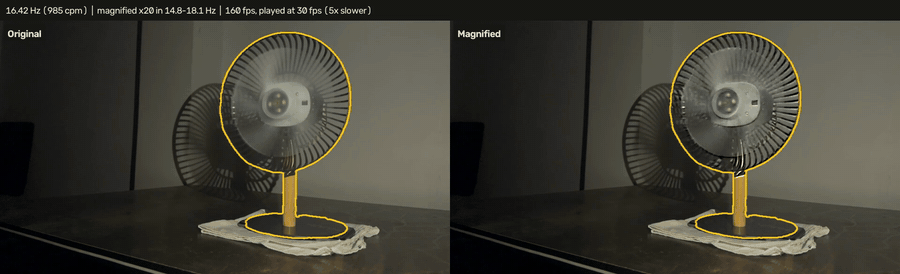
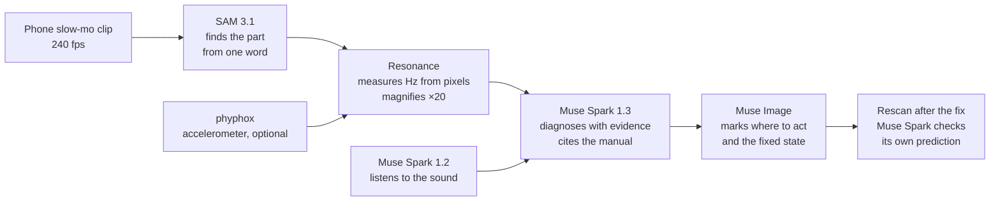

# Resonance

**A vibration analyzer in your pocket.** Film a running machine in slow motion with a phone.
Resonance shows the vibration you can't see, measures its frequency from the pixels, tells you
what is wrong with evidence you can check, shows where to act, and proves the repair worked.

Entry for the **Meta Global AI Developer Hackathon** (Indie Developer track).



<sub>Real footage: a desk fan with putty on one blade. SAM 3.1 outlines the fan; Resonance measures 16.42 Hz from the pixels (a phone accelerometer on the fan agrees) and magnifies it ×20.</sub>

- **Demo video (2:59, 4K):** [youtu.be/QbcBVQ4usqk](https://youtu.be/QbcBVQ4usqk)
- **Live site:** [resonance.mindgears.dev](https://resonance.mindgears.dev): sign up, then try an example clip
- **Code:** this repository, Apache-2.0

## How it works



1. **See.** SAM 3.1 segments the part you name (`fan`, `mirror`, `motor housing`). Motion
   magnification is applied only inside that mask, so invisible shaking becomes visible.
2. **Measure.** The vibration frequency comes straight from the pixels inside the mask
   (sub-pixel motion tracking and a spectrum on the true frame times). A phone accelerometer
   running [phyphox](https://phyphox.org) can be laid on the machine as ground truth.
3. **Diagnose.** Muse Spark weighs the measurements, the magnified video, the sound and the
   equipment manual, and returns ranked faults with evidence. Every manual quote it cites is
   checked against the PDF.
4. **Show the fix.** Muse Image edits the real frame: where to act, and what fixed looks like.
5. **Prove it.** Film again after the repair. Resonance compares the vibration at the fault
   frequency, and Muse Spark judges whether the result matches the prediction it made.

### Which Meta model does what

| Model | Job in Resonance | Where |
|---|---|---|
| **SAM 3.1** | Finds the machine part from a one-word prompt; its mask is where motion is measured and magnified | `resonance/sam_client.py` |
| **Muse Spark 1.3** | Diagnosis: ranked faults with supporting and contradicting evidence, severity, fix plan, manual citations, rotation check against the rated speed; later judges the rescan | `resonance/diagnose.py`, `resonance/compare.py` |
| **Muse Spark 1.2** | Listens to the soundtrack and describes it as extra evidence | `resonance/audio.py`, `resonance/diagnose.py` |
| **Muse Image** | Edits the real key frame: marks where to act and shows the fixed state | `resonance/visualize.py` |

Every call is logged with its estimated cost in `out/costs.jsonl`. A full diagnosis with a
manual attached costs about **$0.14**; SAM 3.1 is $0.0025 a clip.

## Results on real footage

All recorded by us with an iPhone in slow motion; numbers from the runs themselves.

| Case | What Resonance measured | Independent check | Outcome |
|---|---|---|---|
| Desk fan, putty on one blade (night) | 16.42 Hz, 0.227 px | phyphox peak at 16.42 Hz | Imbalance diagnosed; after removing the putty the 16.42 Hz shake fell **97.5 %** (−32 dB) |
| Desk fan, putty on one blade (daylight) | 33.48 Hz = 2,009 RPM, 0.380 px | phyphox 33.48 Hz, **0.02 %** apart; manual: Medium mode 2,070 ± 200 RPM | Imbalance, 82 % confidence, 3/3 manual quotes verified |
| Same fan, dropped on purpose, putty removed | no new harmonics; fan restarted in Low mode, 1,633 RPM (manual: 1,600 ± 200) | phyphox | At its own speed the shake fell **91 %** (camera) and **96 %** (sensor) |
| Motorcycle mirror, idle (Royal Enfield Scram 411) | 44.95 Hz → 1,349 RPM (mirror at 2× crank, inferred) | manual: idle 1,300 ± 100 RPM | Within spec; revving tracked 49 → 59 Hz, phyphox 0.18 % apart |
| JBL Flip 5 playing 60 / 70 / 80 Hz tones | 59.994 / 69.998 / 79.984 Hz | the tone generator | All three within **0.02 Hz** |

## Try it

### On the hosted site

Open [resonance.mindgears.dev](https://resonance.mindgears.dev) and sign up with email and password or GitHub.
No footage needed: **Analyze → Try one of ours** runs the full pipeline on a recorded clip
(the fan with putty, the fan after the fall, the motorcycle, the speaker), and the case-study
runs from this README are open to every account. Or upload your own slow-motion clip.
Each account can run 5 analyses and 3 diagnoses a day. Your own uploads and runs are visible
only to you.

### With the CLI

```bash
pipx install git+https://github.com/Bhaskar422/resonance      # or: uv tool install git+https://github.com/Bhaskar422/resonance
resonance check clip.MOV                                     # free, local (needs ffmpeg): is this clip good enough?
resonance login                                              # approve in the browser, like gh auth login
resonance upload clip.MOV --prompt fan --machine "NUUK LĪT table fan" --accel phyphox.csv --manual manual.pdf
resonance runs                                               # your runs, newest first
resonance pull <run>                                         # download the report, images and magnified video
resonance whoami
resonance logout
```

`upload` checks the clip first (it refuses a 30 fps copy) and prints the report link when the
analysis is done. The token is stored in `~/.config/resonance/credentials.json` (readable only
by you) and sent only to the server it came from. `RESONANCE_SERVER` and `RESONANCE_TOKEN`
override it. `login` uses the hosted site by default; pass `--server` for your own. Scripts
can use an access token from Settings → Access tokens (`--token` or `RESONANCE_TOKEN`).

### Locally, with your own API key

Requirements: Python 3.11+, [uv](https://docs.astral.sh/uv/), ffmpeg on `PATH`.

```bash
uv sync
cp .env.example .env          # put your Meta Model API key in META_API_KEY

uv run resonance demo         # offline: full pipeline on a synthetic clip with a known 17 Hz vibration
uv run resonance analyze clip.MOV --prompt fan --accel phyphox.csv
uv run resonance diagnose out/<run> --manual manual.pdf --machine "desk fan"
uv run resonance visualize out/<run>
uv run resonance compare out/<before-run> out/<after-run>    # after the repair, same camera spot
uv run resonance serve        # web app at http://127.0.0.1:8000 (workspace at /app)
```

No API key? `--box x1,y1,x2,y2` gives the region yourself and skips SAM.

## Accounts and login

The workspace and the API need an account; the marketing site and sample data don't. The first
account on a server is its admin (sees every run and the full cost ledger). Everyone else sees
their own runs plus example runs.

| Sign-in | Notes |
|---|---|
| Email and password | Works out of the box. Passwords hashed with scrypt; sessions and tokens stored only as SHA-256 hashes; repeated failures are rate-limited |
| GitHub | Set `RESONANCE_GITHUB_CLIENT_ID` / `_SECRET`; callback `<server>/api/auth/github/callback` |
| Google | Set `RESONANCE_GOOGLE_CLIENT_ID` / `_SECRET`; redirect `<server>/api/auth/google/callback` |
| CLI | `resonance login` shows a code and opens the site to approve it (device flow) |
| Scripts | Access tokens, sent as `Authorization: Bearer rsn_...` |

A GitHub or Google sign-in joins an existing account only through a verified email.
Settings → Delete account erases the account, its sign-ins, tokens, runs and uploads. The
privacy policy and terms are at `/privacy` and `/terms`. `RESONANCE_AUTH=off` turns accounts off
for a private, single-user install.

## Deployment

The app is one Python process (API, background analysis worker, web app) plus a data folder.
It needs a long-running server with ffmpeg and a disk, so serverless platforms (Vercel
functions, Lambda) don't fit; a small VM does. The hosted site runs this same setup on a small
AWS VM; uploads and runs live on its disk, so no object store (S3) is needed.

```bash
# on a fresh Ubuntu VM (e.g. AWS EC2 t3.large, ports 80 and 443 open) with Docker installed
git clone https://github.com/Bhaskar422/resonance && cd resonance
cp .env.example .env                       # META_API_KEY, OAuth keys, limits
RESONANCE_DOMAIN=resonance.example.com docker compose -f deploy/docker-compose.yml up -d --build
```

`deploy/docker-compose.yml` runs Resonance behind [Caddy](https://caddyserver.com), which
obtains and renews the HTTPS certificate. Point the domain's DNS at the VM first (no domain:
`<ip-with-dashes>.sslip.io` works). Runs, uploads and accounts persist in the `resonance-data`
volume. Register `https://<domain>/api/auth/github/callback` (and the Google one) with the
OAuth apps.

Uploads are capped at 500 MB (`RESONANCE_MAX_UPLOAD_MB`), and the server refuses an upload from
someone not signed in before reading it. Every response carries security headers (HSTS over
HTTPS, `nosniff`, no framing), and cookies are `Secure` behind the HTTPS proxy.

One analysis uses about two CPU cores and peaks near 3 GB of memory (10 s of 240 fps 1080p
footage takes about a minute on a recent laptop and about three on a 2 vCPU cloud VM). Jobs run one at a time by default; on a bigger machine set
`RESONANCE_WORKERS` (e.g. 3 on 8 vCPU / 16 GB) so several people's analyses run side by side.

### Spend limits

Every paid model call starts from three endpoints, and all three are guarded:

| Setting | Default | Effect |
|---|---|---|
| `RESONANCE_DAILY_ANALYSES` | 5 | Analyses (SAM 3.1) per account per day |
| `RESONANCE_DAILY_DIAGNOSES` | 3 | Diagnoses (Muse Spark + Muse Image) per account per day |
| `RESONANCE_DAILY_BUDGET_USD` | 10 in Docker and `.env.example`; off when unset | The whole site stops paid calls for the day once the cost ledger reaches this |

Admins are exempt from the per-account limits, not from the site budget. Requests over a limit
get HTTP 429 with a plain message; `/api/me` reports each account's usage.

## Recording a clip

1. Put the phone on a tripod that does **not** touch the machine or its table. Resonance also
   measures a ring around the part and warns when the camera or the mount moves.
2. Record slow motion at 240 fps, in good light, for 8–12 s, with the part filling about a third
   of the frame. Tap and hold to lock focus and exposure.
3. Transfer the original file (iPhone: AirDrop or share with "All Photos Data"). A 30 fps copy
   can't measure fast vibration; `resonance check` tells you.
4. Optional ground truth: lay a second phone on the machine running phyphox, "Acceleration
   (without g)", and export CSV. Android phones sample at about 200 Hz, iPhones at about 100 Hz.

## Honest limits

- The highest measurable frequency is half the frame rate that actually arrives. iPhones record
  slow motion on a 240 fps clock but deliver about 160 frames a second, so the limit is about
  80 Hz for magnification and 120 Hz for measurement on the true timestamps.
- Mirrors, brackets and stems often shake at a multiple of the running speed. Converting Hz to
  RPM can need an inference (the bike above), which the film and reports mark as such.
- The rescan compares the same frequency before and after. If the machine's speed changed
  between takes, compare each take at its own running speed (we did for the dropped fan).
- Google sign-in stays in testing mode until the OAuth brand is verified on the final domain.

## The demo video

[Watch on YouTube](https://youtu.be/QbcBVQ4usqk) (2:59, 4K). Made in code, not edited by hand: every
number on screen comes from the runs above.

- Style and production tools: the "Visual Investigation" style from
  [Lemo-Opuscar](https://github.com/lemomo-ai/lemo-opuscar) (MIT, styles CC BY 4.0).
- Narration: [Chatterbox TTS](https://github.com/resemble-ai/chatterbox) (MIT), music: original
  score and techno generated with [ACE-Step 1.5](https://github.com/ace-step/ACE-Step-1.5) (MIT),
  both run locally on an NVIDIA DGX Spark, which also rendered the film.
- Footage: our own recordings. Manual pages shown as evidence: NUUK LĪT User Guide and Royal
  Enfield Scram 411 owner's manual. Plate and face in the motorcycle footage are blurred.

## Built during the hackathon (Oct 27 – Nov 4, 2026)

All code in this repository was written during the hackathon; the git history is the record.

| Component | Path | What it does |
|---|---|---|
| Frequency measurement | `resonance/frequency.py` | Lucas–Kanade motion inside a mask, spectra on true timestamps, peak refinement, harmonics, light-flicker rejection |
| Masked motion magnification | `resonance/magnify.py` | Streaming linear Eulerian magnification, applied only inside the mask |
| Video I/O for any phone | `resonance/io.py` | Rotation, HDR tone-mapping, variable frame rate, re-timed slow-mo correction |
| Accelerometer ground truth | `resonance/accel.py` | phyphox CSV/zip (iOS and Android), video-vs-sensor comparison with Nyquist checks |
| Meta Model API client and cost ledger | `resonance/api.py` | Every call logged with an estimated cost; refuses Contributor-mode models |
| SAM 3.1 client | `resonance/sam_client.py` | Image and video segmentation, decoded with `meta_sam_parser` |
| Analysis pipeline | `resonance/pipeline.py`, `resonance/report.py` | Mask → measure → magnify → spectrum plot, side-by-side video, `report.json` |
| Diagnosis | `resonance/diagnose.py`, `resonance/audio.py` | Muse Spark 1.3 strict-schema fault report; Muse Spark 1.2 listens; citations verified against the PDF |
| Fix visualization | `resonance/visualize.py` | Muse Image edits of the real key frame |
| Rescan after fix | `resonance/compare.py` | Before/after at the fault frequency and harmonics, verdict, Muse Spark check |
| Web API and accounts | `resonance/server.py`, `resonance/auth.py`, `resonance/oauth.py` | Uploads, background jobs, runs, rescans, accounts, OAuth, tokens, device login, spend limits |
| CLI | `resonance/cli.py`, `resonance/remote.py`, `resonance/clipcheck.py` | Local analysis, plus `check`, `login`, `upload`, `runs`, `pull`, `whoami`, `logout` |
| Web app | `frontend/` (built into `resonance/web/dist/`) | React + Tailwind: site, dashboard, machines, guided analysis, run report, certificate of fix, recording guide, usage and cost, settings |
| Deployment | `Dockerfile`, `deploy/docker-compose.yml` | One container behind Caddy with automatic HTTPS |
| Tests | `tests/` | 79 tests, all offline: `uv run pytest` |

Each run writes `out/<run>/`: `side_by_side.mp4` (original and magnified), `spectrum.png`,
`report.json`, `mask_overlay.png`, `signals.npz`, and after the later steps `diagnosis.json`,
`where_to_act.png`, `fixed_state.png`, `compare.json`.

To change the web app: `cd frontend && bun install && bun run dev` (proxies the API on :8000),
then `bun run build` to write `resonance/web/dist/`.

## Third-party credits and licenses

| Material | Use | License |
|---|---|---|
| [Meta Model API](https://dev.meta.ai/docs) (SAM 3.1, Muse Spark 1.3 and 1.2, Muse Image) | Hosted models called over HTTPS | Meta Model API terms |
| [meta-sam-parser](https://github.com/meta-models/meta-sam) | Parses SAM 3.1 output (pip dependency, not vendored) | [SAM License](https://github.com/meta-models/meta-sam/blob/main/LICENSE) |
| [phyphox](https://phyphox.org) (RWTH Aachen University) | Phone accelerometer recordings used as ground truth (app, not bundled) | phyphox terms |
| NumPy, SciPy | Numerics, FFT, filters | BSD-3-Clause |
| OpenCV (`opencv-python`) | Video decoding, image pyramids | Apache-2.0 |
| Matplotlib | Spectrum plots | Matplotlib License (BSD-style) |
| Typer | CLI | MIT |
| OpenAI Python SDK | HTTP client for the OpenAI-compatible Meta Model API | Apache-2.0 |
| httpx | CLI HTTP client | BSD-3-Clause |
| python-dotenv | Loads `.env` | BSD-3-Clause |
| pypdf | Reads manual text to verify citations | BSD-3-Clause |
| FastAPI, Starlette, Uvicorn, python-multipart | Web API and server | MIT, BSD-3-Clause, BSD-3-Clause, Apache-2.0 |
| React, Vite, Tailwind CSS | Web app | MIT |
| [IBM Plex Sans and Mono](https://github.com/IBM/plex) | Web app typefaces | SIL Open Font License 1.1 |
| FFmpeg | Video probing and decoding (external binary, not distributed) | LGPL/GPL |
| Caddy | HTTPS reverse proxy in the deployment (container image, not distributed) | Apache-2.0 |
| Demo video only: Lemo-Opuscar, Chatterbox TTS, ACE-Step 1.5, Noto Sans, Source Serif 4 | Film style and tools, narration, music, typefaces | MIT, MIT, MIT, OFL, OFL (Lemo-Opuscar styles CC BY 4.0) |

Methods implemented from the literature (our own code, no reference implementations used):

- H.-Y. Wu, M. Rubinstein, E. Shih, J. Guttag, F. Durand, W. T. Freeman. *Eulerian Video
  Magnification for Revealing Subtle Changes in the World.* ACM SIGGRAPH 2012.
- B. D. Lucas, T. Kanade. *An Iterative Image Registration Technique with an Application to
  Stereo Vision.* IJCAI 1981.
- G. Farnebäck. *Two-Frame Motion Estimation Based on Polynomial Expansion.* SCIA 2003
  (via OpenCV, as a cross-check).

## License

Apache-2.0. See [LICENSE](LICENSE).
